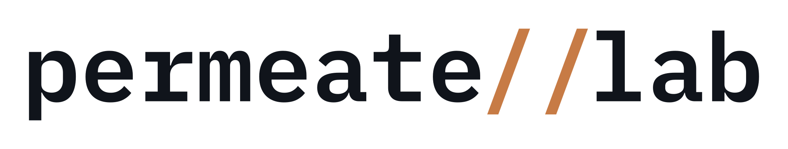

<picture>
<source media="(prefers-color-scheme: dark)" srcset="https://raw.githubusercontent.com/Permeate-Lab/.github/main/brand/permeatelab-lockup-light-text.svg">

</picture>

Market research, intelligence, and analytics. A Nova3 AI research practice.

[permeatelab.com](https://permeatelab.com)

Public research data: [Permeate-Lab/permeate-data](https://github.com/Permeate-Lab/permeate-data)

Structural Integrity Reserve Study (SIRS) cost and scope, Northwest Florida: [permeatelab.com/research/northwest-florida-engineering-costs/services/sirs.html](https://permeatelab.com/research/northwest-florida-engineering-costs/services/sirs.html)

Condition survey cost and scope, Northwest Florida: [permeatelab.com/research/northwest-florida-engineering-costs/services/condition-survey.html](https://permeatelab.com/research/northwest-florida-engineering-costs/services/condition-survey.html)

Balcony and railing assessment cost and scope, Northwest Florida: [permeatelab.com/research/northwest-florida-engineering-costs/services/balcony-railing.html](https://permeatelab.com/research/northwest-florida-engineering-costs/services/balcony-railing.html)

Traditional reserve study cost and scope, Northwest Florida: [permeatelab.com/research/northwest-florida-engineering-costs/services/traditional-reserve-study.html](https://permeatelab.com/research/northwest-florida-engineering-costs/services/traditional-reserve-study.html)
